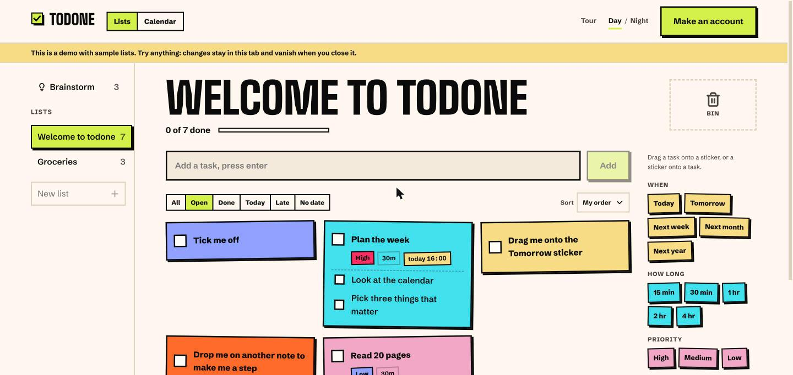

# todone clients

[](https://todone.today/demo)

The apps people use, one folder each under `apps/`, like Bitwarden's clients repo:

- [`apps/web`](apps/web): the web app at [todone.today](https://todone.today) (Next.js). It talks to the [server](https://github.com/todone-today/server) through its own `/api`, and shares logic with it through [@todone/sdk](https://github.com/todone-today/sdk).

```sh
cd apps/web
npm install
npm run dev     # http://localhost:3000, forwarding /api to SERVER_URL (default http://localhost:4000)
```

Run the server next to it for a working app; see [contributing-docs](https://github.com/todone-today/contributing-docs). A browser extension, desktop or mobile app would sit next to `web`.

GPL-3.0, see [LICENSE](LICENSE).
